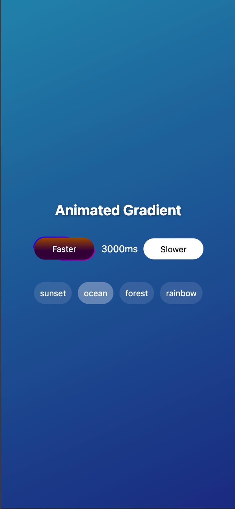
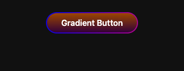
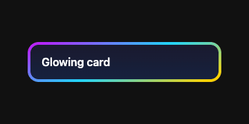
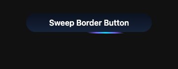
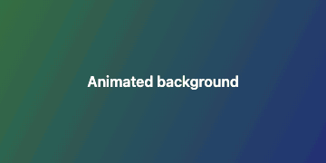

# react-native-gradient-wrapper

A React Native wrapper component that adds gradient backgrounds and gradient borders, with optional rotation and color animation. Works with Expo (`expo-linear-gradient`) and bare React Native (`react-native-linear-gradient`).

- Gradient backgrounds and borders, set by angle
- Color animation that cycles through the background colors
- Rotating background or border, with an optional stop timer
- Per-side border gradients
- Light, dark and system-theme defaults
- Scale feedback when pressed

Animations run on the native driver, so they don't block the JS thread.



## Installation

**Expo**

```bash
npx expo install react-native-gradient-wrapper expo-linear-gradient
```

**Bare React Native**

```bash
npm install react-native-gradient-wrapper react-native-linear-gradient
cd ios && pod install
```

## Importing

Import from the entry point that matches the gradient library you installed. Metro then bundles only that library.

```tsx
// Expo
import { GradientWrapper } from 'react-native-gradient-wrapper/expo';

// Bare React Native
import { GradientWrapper } from 'react-native-gradient-wrapper/linear-gradient';
```

The root import, `'react-native-gradient-wrapper'`, still works. It picks a library at runtime, which some Metro setups can't bundle when only one of the two libraries is installed. Prefer one of the entry points above.

To use a different LinearGradient-compatible component, build your own wrapper:

```tsx
import { createGradientWrapper } from 'react-native-gradient-wrapper/expo';
import MyGradient from './MyGradient';

export const GradientWrapper = createGradientWrapper(MyGradient);
```

## Examples

### Gradient border button



```tsx
<GradientWrapper
  borderGradient={['rgba(0, 0, 255, 0.9)', 'rgba(186, 0, 146, 0.97)']}
  borderAngle={46}
  borderWidth={2}
  borderRadius={30}
  backgroundGradient={['rgb(155, 70, 0)', 'rgb(50, 0, 56)']}
  angle={90}
  contentStyle={{ padding: 10, alignItems: 'center' }}
  onPress={() => console.log('pressed')}
>
  <Text style={{ color: '#fff' }}>Gradient Button</Text>
</GradientWrapper>
```

### Spinning border



The border turns continuously. `borderRotationSpeed` is the time for one full turn. With `stopBorderAfter`, the current turn finishes and the border comes to rest.

```tsx
<GradientWrapper
  borderGradient={['#ff512f', '#ffd200', '#21d4fd', '#b721ff', '#ff512f']}
  borderAngle={0}
  borderRotation="clockwise"
  borderRotationSpeed={3000}
  stopBorderAfter={30000}
  borderWidth={4}
  borderRadius={16}
  backgroundGradient={['#1a1a2e', '#16213e']}
  angle={90}
>
  <Text style={{ color: '#fff', padding: 16 }}>Glowing card</Text>
</GradientWrapper>
```

### Sweep border



With `borderSweep`, the border shows one short highlight that travels around the whole control instead of a full spinning gradient. The first color in `borderGradient` is the center of the highlight and the second color is its edges. `borderSweepSpan` sets roughly how much of the border the highlight covers, from 0 to 1.

```tsx
<GradientWrapper
  borderGradient={['#00e5ff', '#7b61ff']}
  borderRotation="clockwise"
  borderRotationSpeed={6000}
  borderSweep
  borderSweepSpan={0.2}
  borderWidth={3}
  borderRadius={28}
  backgroundGradient={['#0b1220', '#152238']}
  angle={90}
  contentStyle={{ padding: 10, paddingHorizontal: 28, alignItems: 'center' }}
  onPress={() => {}}
>
  <Text style={{ color: '#fff' }}>Sweep Border Button</Text>
</GradientWrapper>
```

`borderSweep` only applies while the border is rotating. Use an opaque background: with `noFill` or `overlayBg`, the highlight also shows through the middle of the control.

### Animated background



With `animated`, the background cycles through every color in `backgroundGradient`. `backgroundRotationSpeed` sets how long each color step takes.

```tsx
<GradientWrapper
  animated
  backgroundGradient={['#5A3F37', '#2C7744', '#1A2980']}
  backgroundRotationSpeed={1500}
  angle={46}
  borderWidth={0}
  borderRadius={0}
  style={{ flex: 1 }}
>
  <Text style={{ color: '#fff' }}>Animated background</Text>
</GradientWrapper>
```

[Watch the demo video](https://github.com/bersuad/react-native-gradient-wrapper/blob/main/docs/assets/gradient-demo.mp4)

### Per-side borders

```tsx
<GradientWrapper
  borderTopGradient={['#ff512f', '#dd2476']}
  borderBottomGradient={['#1a2980', '#26d0ce']}
  borderWidth={3}
>
  <Text style={{ padding: 16 }}>Top and bottom borders</Text>
</GradientWrapper>
```

## Props

All props are optional except `children`.

### Layout

| Prop           | Type                   | Default | Description                                     |
| -------------- | ---------------------- | ------- | ----------------------------------------------- |
| `children`     | `ReactNode`            |         | Content to render inside the wrapper.           |
| `style`        | `StyleProp<ViewStyle>` |         | Style for the outer container (size, margin).   |
| `contentStyle` | `StyleProp<ViewStyle>` |         | Style for the inner content view (padding).     |
| `borderWidth`  | `number`               | `2`     | Border thickness. Use `0` for no border.        |
| `borderRadius` | `number`               | `10`    | Corner radius. Use a large value for a pill.    |

### Background

| Prop                      | Type                                       | Default         | Description                                                                                   |
| ------------------------- | ------------------------------------------ | --------------- | --------------------------------------------------------------------------------------------- |
| `backgroundGradient`      | `string[]`                                 | theme default   | Background colors.                                                                            |
| `backgroundLocations`     | `number[]`                                 |                 | Color stop positions from 0 to 1. With `animated`, only used if it has exactly 2 values.      |
| `angle`                   | `number`                                   |                 | Gradient direction in degrees. `0` is left to right, `90` is top to bottom.                   |
| `animated`                | `boolean`                                  | `false`         | Cycle through the background colors. Needs at least 2 colors.                                 |
| `backgroundRotation`      | `'clockwise' \| 'anticlockwise' \| 'none'` | `'none'`        | Spin the background.                                                                          |
| `backgroundRotationSpeed` | `number`                                   | `4000`          | Milliseconds per full turn when rotating, and per color step when `animated`.                 |
| `stopBackgroundAfter`     | `number`                                   |                 | Stop the background rotation after this many milliseconds.                                    |
| `noFill`                  | `boolean`                                  | `false`         | Skip the background and keep it transparent. With `borderGradient`, draws a solid border from its first color. |
| `overlayBg`               | `boolean`                                  | `false`         | Make the background colors transparent while still rendering the gradient layer.             |

### Border

| Prop                   | Type                                       | Default       | Description                                                       |
| ---------------------- | ------------------------------------------ | ------------- | ----------------------------------------------------------------- |
| `borderGradient`       | `string[]`                                 | theme default | Colors for the whole border.                                      |
| `borderLocations`      | `number[]`                                 | even spacing  | Color stop positions. Ignored unless it matches `borderGradient`. |
| `borderAngle`          | `number`                                   |               | Border gradient direction in degrees.                             |
| `borderTopGradient`    | `string[]`                                 |               | Top border colors.                                                |
| `borderBottomGradient` | `string[]`                                 |               | Bottom border colors.                                             |
| `borderLeftGradient`   | `string[]`                                 |               | Left border colors.                                               |
| `borderRightGradient`  | `string[]`                                 |               | Right border colors.                                              |
| `borderRotation`       | `'clockwise' \| 'anticlockwise' \| 'none'` | `'none'`      | Spin the border.                                                  |
| `borderRotationSpeed`  | `number`                                   | `3000`        | Milliseconds per full turn.                                       |
| `stopBorderAfter`      | `number`                                   |               | Stop the border rotation after this many milliseconds.            |
| `borderSweep`          | `boolean`                                  | `false`       | While rotating, show one highlight travelling around the border.  |
| `borderSweepSpan`      | `number`                                   | `0.22`        | Roughly how much of the border the sweep highlight covers, 0–1.   |

`borderGradient` takes priority over the per-side props. When one or two sides are set, each side is drawn separately. When three or four sides are set, their colors are joined into one gradient around the border.

### Theme and interaction

| Prop             | Type                          | Default  | Description                                                     |
| ---------------- | ----------------------------- | -------- | --------------------------------------------------------------- |
| `theme`          | `'light' \| 'dark' \| 'auto'` | `'auto'` | Picks the default colors. `'auto'` follows the system setting.  |
| `onPress`        | `() => void`                  |          | Makes the wrapper pressable.                                    |
| `onLongPress`    | `() => void`                  |          | Long-press handler. Also makes the wrapper pressable.           |
| `enableFeedback` | `boolean`                     | `true`   | Scale down slightly while pressed.                              |

### Notes

- Set `angle` and `borderAngle` to get a visible gradient direction. Without them the start and end points are the same, which matches 1.0.x behavior.
- Rotating layers are sized to the container's diagonal, so the corners stay covered while they spin.

## Comparison

| Feature                       | react-native-gradient-wrapper | react-native-linear-gradient | react-native-gradients | react-native-animated-linear-gradient |
| ----------------------------- | ----------------------------- | ---------------------------- | ---------------------- | ------------------------------------- |
| Background gradient           | Yes                           | Yes                          | Yes                    | Yes                                   |
| Border gradient               | Yes                           | No                           | No                     | No                                    |
| Animated color transition     | Yes                           | No                           | No                     | Background only                       |
| Rotation animation            | Yes                           | No                           | No                     | No                                    |
| Per-side border control       | Yes                           | No                           | No                     | No                                    |
| Theme-aware default colors    | Yes                           | No                           | No                     | No                                    |
| Press feedback                | Yes                           | No                           | No                     | No                                    |
| Angle-based direction         | Yes                           | Yes                          | Yes                    | Yes                                   |
| Stop animations after a delay | Yes                           | No                           | No                     | No                                    |

GradientWrapper draws its gradients with `expo-linear-gradient` or `react-native-linear-gradient`, depending on the entry point you import.

## Development

```bash
npm install
npm run typecheck   # TypeScript
npm run lint        # ESLint and Prettier
npm test            # Jest
npm run build       # CommonJS, ES modules and type definitions in lib/
```

The demo app in `demo/demo` is an Expo project:

```bash
cd demo/demo && npm install && npx expo start
```

## License

MIT
